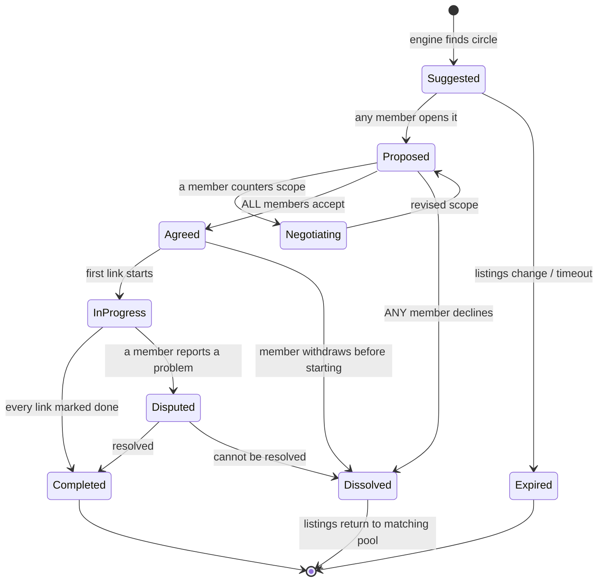

# Domain model (v0)

A proposal for [issue #1](https://github.com/phanidileep4/barterSystem/issues/1): the smallest model that carries a voluntary exchange from listing to completion, for both pairs and multi-party circles. A pair is simply a circle of two, so one model covers both.

## Entities

| Entity | Purpose | Key fields | Sensitivity |
|---|---|---|---|
| **Participant** | A person in one community | `id`, `display_name`, `community_id`, `zone`, `max_travel_zones`, `availability[]` | Name: personal. Zone: coarse on purpose. No address, no phone in matching. |
| **Listing** | One offer or one need | `id`, `participant_id`, `kind` (offer/need), `text`, `mode` (in_person/remote/either), `effort_hours?`, `status` (active/paused/closed) | Free text: may contain personal data; only this text may go to an AI step. |
| **Block** | One-way "never match me with this person" | `blocker_id`, `blocked_id`, `created_at` | Private. Never revealed to the blocked person, including through explanations. |
| **Circle** (match suggestion) | A proposed closed loop | `id`, `links[]`, `confidence`, `explanation`, `generated_at`, `engine_version` | Derived. Expires; regenerated freely. |
| **Link** | One giving step inside a circle | `giver_id`, `receiver_id`, `offer_id`, `need_id`, `shared_concepts[]`, `safety_notes[]` | Derived. |
| **Agreement** | What participants actually agree to | `circle_id`, per-link `scope` text, `responses{participant_id: accepted/declined/countered}` | Personal; kept for dispute handling, deletable on request after a retention period. |
| **Feedback** | Per-link completion record | `link_id`, `from_id`, `completed` (bool), `note?` | Contextual only. Never aggregated into a single global score. |
| **Report** | Safety or abuse report | `reporter_id`, `subject_id?`, `circle_id?`, `reason`, `status` | Sensitive; human-reviewed. |

## Circle lifecycle



Rules that matter:

- **All-or-nothing start.** No link begins until the whole circle is `Agreed`, so nobody gives without a committed path to receiving.
- **Declining is free.** A `Dissolved` circle leaves no trace on anyone's record; the listings go back into the pool.
- **Withdrawal mid-circle** (after someone has already given) is the hardest case. v0 handles it through `Disputed` and human support; a later version might let the engine find a replacement giver.

## Example records

```json
{
  "participant": { "id": "p1", "display_name": "Asha", "community_id": "maple-commons",
                   "zone": "north", "max_travel_zones": 1, "availability": ["weekday_evening", "weekend"] },
  "listing":     { "id": "p1-o1", "participant_id": "p1", "kind": "offer",
                   "text": "Tutoring in high school math and physics", "mode": "either", "effort_hours": 4 },
  "circle": {
    "id": "c-0007", "confidence": 0.74, "engine_version": "proto-0.1",
    "links": [
      { "giver_id": "p1", "receiver_id": "p3", "offer_id": "p1-o1", "need_id": "p3-n1",
        "shared_concepts": ["math", "teaching"],
        "safety_notes": ["Involves a minor: keep sessions remote or with a guardian present."] }
    ]
  }
}
```

## Deliberately out of v0

Credits or balances, prices, global reputation, chat (use the community's existing channels), payments, and multi-community federation.
